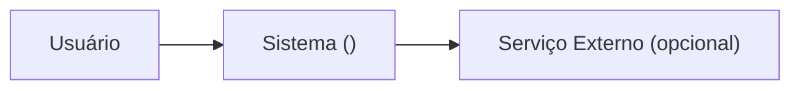
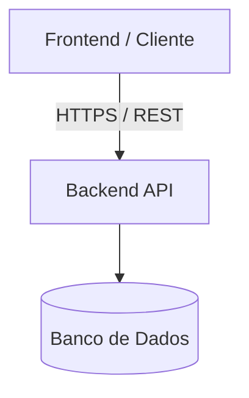

# Arquitetura e Diagramas C4

## 1. Diagrama de Contexto (C1)

## 2. Diagrama de Containers (C2)

## 3. Componentes e Camadas (C3)

<!-- Descreva os módulos/camadas e suas fronteiras de dependência. -->
