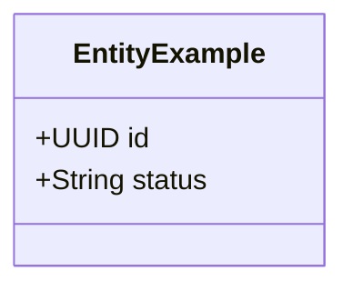
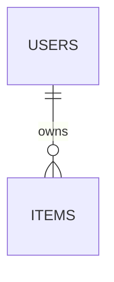
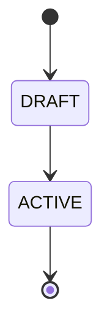

# Modelo de Domínio e Dados

## 1. Diagrama de Classes / Agregados

## 2. Modelo de Persistência (ER / Coleções)

## 3. Índices e Constraints

<!-- Liste índices únicos, compostos, TTL e constraints relevantes. -->

## 4. Máquina de Estados

